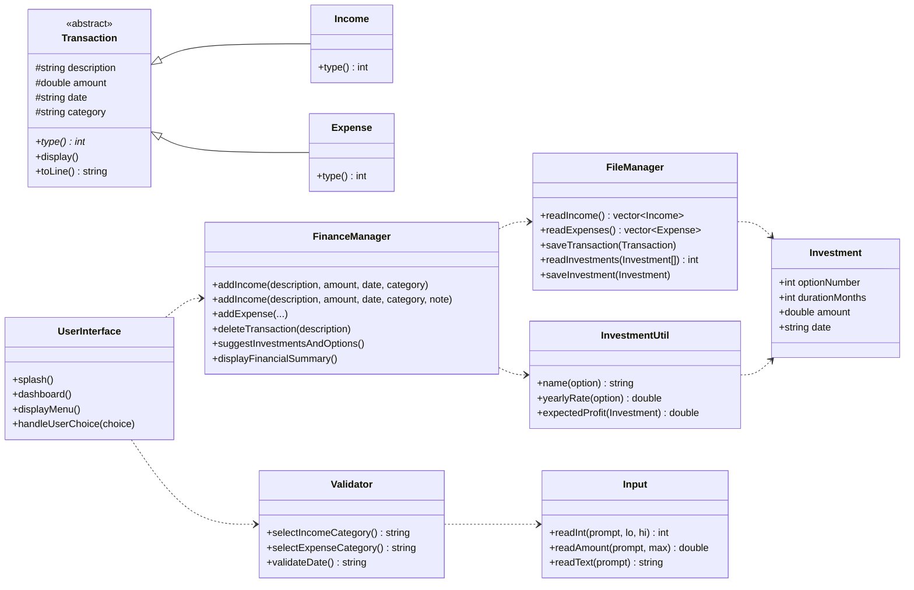
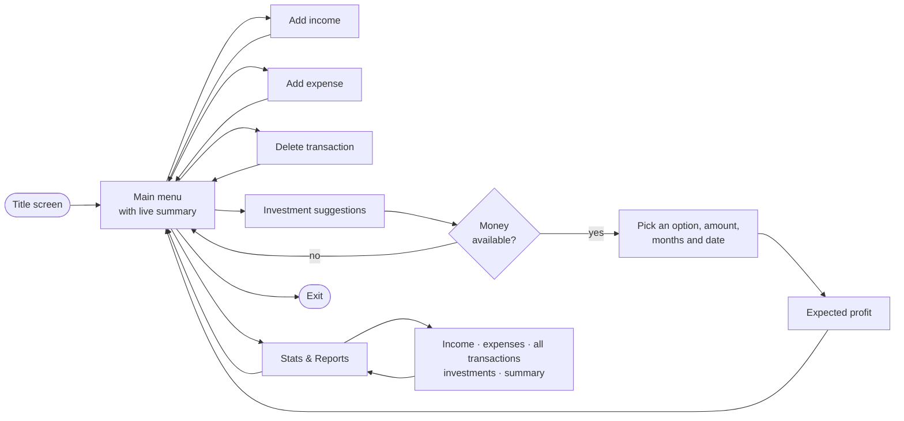

# Finance Flare

<p align="center">
  <a href="https://husseinhany.github.io/#projects"></a>
</p>

A personal finance manager for the terminal, written in C++. Record income and expenses, see where the money went, and test investment options with their expected returns. Everything is saved to plain text files, so your data is still there the next time you open it.

Final project for the C++ OOP course by **Byte Masters**, a team of six: Hussein Hany, Nour Alaa, Mohamed Ismail, Ahmed Walid, Eslam Mohamed and Abdallah Aboghaly. This copy is forked from the [team repository](https://github.com/MOMGD/Finance-Flare) and adds the fixes and improvements listed below.

<p align="center">
  
</p>

<p align="center"><sub>Real output from the program: the title screen, adding income, a refused date, an investment with its expected profit, and the summary.</sub></p>

## What it does

| Menu | What you can do |
| --- | --- |
| **Add Income** | Pick a category (Salary, Business, Investment, Gift, Other), add a description, an optional note, the amount and the date |
| **Add Expense** | Pick one of 10 categories (Food, Housing, Transportation…), add a description, the amount and the date |
| **Delete Transaction** | Remove a transaction by its description; the program says how many it removed |
| **Investment Suggestions** | See income, expenses, money already invested and what is left. Under $10,000 you also get a suggested split across starter options. Pick one of 20 options, invest part of your available money and see the expected profit |
| **Stats & Reports** | Income, expenses, all transactions in date order, your investments, and a financial summary with bars showing where the income went |

The main menu shows your money at a glance every time it opens: total in, total out and what is available.

## Interactive and animated

- An animated title screen when the program starts
- A live summary line on the main menu
- A spinner while the investment suggestions are prepared
- Bars that grow in the financial summary
- Colours for income, expenses and warnings, and clear messages when an answer is not valid

The animations only run in a real terminal. When input or output is piped, for example in tests, the program runs at full speed.

## How it is built



The course asked for these, and this is where each one is:

| Requirement | Where |
| --- | --- |
| Inheritance | `Income` and `Expense` inherit from the abstract `Transaction` class |
| Arrays of objects | Investments are read into an `Investment` array (up to 100) |
| Static arrays | The 20 investment options and the starter split are constant arrays |
| File operations | `FileManager` reads and writes the four data files |
| Function overloading | `addIncome` with and without a note |
| Multi-level menus | Main menu, Stats & Reports menu, and the investment options menu |

### Menus



## Investment returns

Each of the 20 options has an expected yearly return, from 38% for high-risk investments down to 1.2% for education. The expected profit is simple interest:

```
expected profit = amount × yearly return × months ÷ 12
```

For example, $1,000 in the stock market option (28% a year) for 12 months gives $280.00 of expected profit. The rates are fixed teaching values, not live market data.

## Build and run

Any C++11 compiler works, on Windows, macOS or Linux.

```bash
g++ -std=c++11 -O2 main.cpp -o finance_flare
./finance_flare
```

On Windows with Visual Studio, add `main.cpp` to an empty console project and run it. Colours are switched on automatically in the Windows console.

## Data files

The program creates these files next to itself. Each line is one record, with fields separated by commas.

| File | One line per | Fields |
| --- | --- | --- |
| `income.txt` | income | description, amount, date (DD/MM/YYYY), category |
| `expense.txt` | expense | description, amount, date, category |
| `transactions.txt` | income or expense | description, amount, date, category |
| `investments.txt` | investment | option number, months, amount, date |

A comma typed in a description is saved as a semicolon, so it can't split a record. A damaged line is skipped instead of stopping the program.

## Fixes and improvements in this fork

- **No more freezes:** typing a letter at any menu or number prompt froze the program, and a wrong choice on the investment menu looped forever. Every answer is now read as a whole line and checked, and closed input exits cleanly.
- **The right investment every time:** the option you picked, the name shown and the return used didn't match (choosing option 2 printed "Low-risk Investment" but used the Venture Capital rate). One table now holds each option's name and rate.
- **Realistic returns:** the rates were applied per month, so 38% became 38% a month. They are now yearly rates, as the menu shows them.
- **Correct balance:** the "Available Balance" column showed the balance before investments; it now subtracts them, and you can't invest money that is already invested.
- **The income note is saved:** the note was asked for but never stored, and an extra `cin.ignore()` cut off its first letter.
- **Under $10,000 the suggestions add up:** the starter split added up to 105%; it now adds up to 100%, and you can still choose any of the 20 options.
- **Safe file reading:** a comma in a description broke the saved record, and a damaged number crashed the program.
- **Works everywhere:** `system("cls")` and `system("pause")` only worked on Windows.
- **Clearer numbers:** amounts show as `$1,234.56`, transaction lists are tables with totals, and "All Transactions" is sorted by date and labels income and expenses.
- **New:** the animated title screen, the live summary on the main menu, the spinner and the growing bars.

Tested with memory and undefined-behaviour checks (`-fsanitize=address,undefined`) on a scripted session covering every menu, wrong answers, impossible dates, closed input and damaged data files.

## Files

| File | What it is |
| --- | --- |
| `main.cpp` | The program |
| `docs/report.md` | The team's project report |
| `docs/overview.md` | A longer description of the system written for the course |
| `docs/banner.svg`, `docs/demo.svg` | The animated banner and terminal recording in this README |
| `drafts/` | Earlier versions kept from the team's development |
